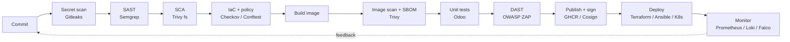

# DevSecOps Roadmap and Progress Tracker

Tick the boxes as you finish each lab. Each phase has its own guide in this folder.

## Target pipeline

## Progress

### Phase 1 - Foundations ([guide](01-foundations.md))
- [ ] Linux CLI comfortable in WSL2
- [ ] Git workflow (branches, pull requests, signed commits)
- [ ] Bash script written and committed (`scripts/healthcheck.sh` extended)
- [ ] Reverse proxy with TLS in front of Odoo

### Phase 2 - Containers and CI/CD ([guide](02-containers-cicd.md))
- [ ] Dockerfile hardened (non-root, pinned, minimal)
- [ ] GitHub Actions pipeline green on `main`
- [ ] Branch protection requires the pipeline

### Phase 3 - Security in the pipeline ([guide](03-security-pipeline.md))
- [ ] All six "break the pipeline" exercises done and triaged
- [ ] False positives suppressed with justification
- [ ] SBOM generated and image signed

### Phase 4 - IaC and cloud ([guide](04-iac-cloud.md))
- [ ] `terraform apply` and `destroy` completed
- [ ] Checkov findings fixed or formally accepted
- [ ] Ansible hardening run + Lynis score recorded

### Phase 5 - Kubernetes and runtime security ([guide](05-kubernetes.md))
- [ ] Odoo running on k3d
- [ ] NetworkPolicy and Pod Security verified
- [ ] Kyverno in Enforce mode, Falco alert triggered

### Phase 6 - Observability and compliance ([guide](06-observability-compliance.md))
- [ ] Grafana dashboards + Loki failed-login query
- [ ] Policy-as-code mapped to ISO 27001 ([mapping](iso27001-mapping.md))
- [ ] Incident runbook written

## Suggested certifications (optional, in this order)
1. AWS Cloud Practitioner or Azure AZ-900
2. HashiCorp Terraform Associate
3. CKA, then CKS
4. AWS Security Specialty or Azure AZ-500

## Portfolio checklist
- [ ] README explains every control and why it exists
- [ ] Screenshots of a failed gate and the fixed run
- [ ] At least three findings written up with [the report template](finding-report-template.md)
- [ ] Architecture diagram kept up to date
